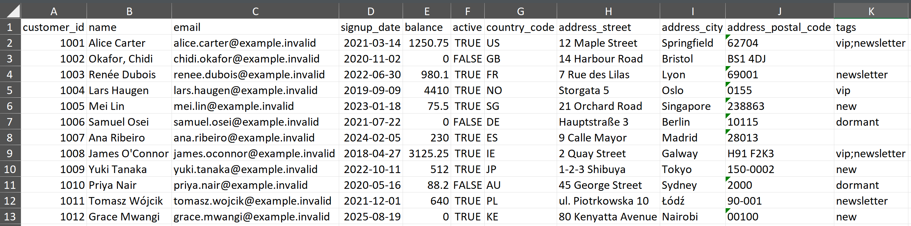

# 9. Excel

Excel is the format most business users live in, and the one most often read by programs that were never meant to read it. A workbook looks like a set of tables, but it is a container with its own rules: several sheets, cells that hold typed values or formulas, and a display format that can hide what is stored. A program that reads a workbook as a grid of text will miss most of that. This chapter covers the modern `.xlsx` format and the older binary `.xls`, the types a cell can hold, numbers stored as text, formula cells, and writing a workbook.

The sample files are `customers.xlsx` (two sheets, `customers` and `orders`), `customers.xls` (the same data in the legacy format), `customers-text-numbers.xlsx` (numbers stored as text), and `customers-formula.xlsx` (a formula in a name cell). Here is the first part of `customers.xlsx` as Excel shows it:

Three things in the picture matter for the chapter. The balances show no trailing zeros, because the display format rounds them, and the stored value is what a program reads. The green triangles on the postal codes mark numbers stored as text, which the generator wrote on purpose. And `TRUE` and `FALSE` are real booleans, not the text the CSV held.

**Libraries.** C# uses ClosedXML 0.105.1 (MIT), declared in each sample with a `#:package` line, along with `System.IO`. Python uses `openpyxl` 3.1.5 (MIT), `xlrd` 2.0.1 (BSD, for the legacy `.xls` sample only), and `os`. JavaScript uses `exceljs` 4.4.0 (MIT), declared in `samples\package.json`, along with `node:fs` and `node:path`. Install the JavaScript packages with `npm install` in `samples` before running the JavaScript samples. The legacy `.xls` sample is Python only, because neither ClosedXML nor `exceljs` reads that format.

The chapter has a reading step, five samples, two homework items, and a summary with three quizzes.

---
