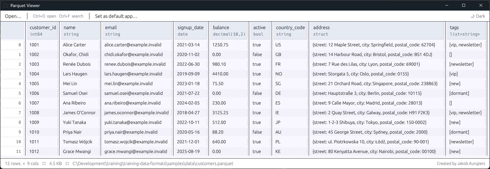

# 10. Parquet

Parquet is the format of analytics. A Parquet file stores a table by column rather than by row, with compression and type information built in, so a query that needs three columns out of fifty reads only those three. Data pipelines, data lakes, and the big analytics engines use it, and a file from one of them arrives in your hands as a Parquet file, not as text you can open in an editor. This chapter covers the file's structure, reading and writing it, nested columns, and the way Parquet keeps types that the text formats never could.

The sample files are `customers.parquet`, which holds the twelve customers, and the same data is used in the homework. Here is the file open in a Parquet viewer. The viewer is Fast Parquet Viewer, a free app from the Windows Store at [Fast Parquet Viewer - Microsoft Store](https://apps.microsoft.com/detail/9p7vs5f8qntg?hl=en-US&gl=MP). Windows has no built-in Parquet application, so a viewer from the Store is the practical way to look inside a file like this one. Notice the types in each column header: the balance is `decimal(10,2)`, the address is a `struct`, and the tags are a `list<string>`. The 12 rows and 9 columns match the dataset.

The types in the header are the point of the format. A CSV file can't say that the balance is a two-decimal number, and an Excel file can only say it through a display format. The Parquet file stores the type with the data, so the reader gets `0.00` as a decimal and `tags` as a list.

**Libraries.** C# uses Parquet.Net 5.6.1 (MIT), declared in each sample with a `#:package` line, along with `System.IO` and `System.Linq`. Python uses `pyarrow` 26.0.1 (Apache-2.0), which is already pinned in `requirements.txt`, and `os`. JavaScript uses `hyparquet` 1.26.2 for reading and `hyparquet-writer` 0.15.6 for writing, both MIT, declared in `samples\package.json`, along with `node:path`. Install the JavaScript packages with `npm install` in `samples` before running the JavaScript samples.

The chapter has a reading step, three samples, two homework items, and a summary with three quizzes.

---
